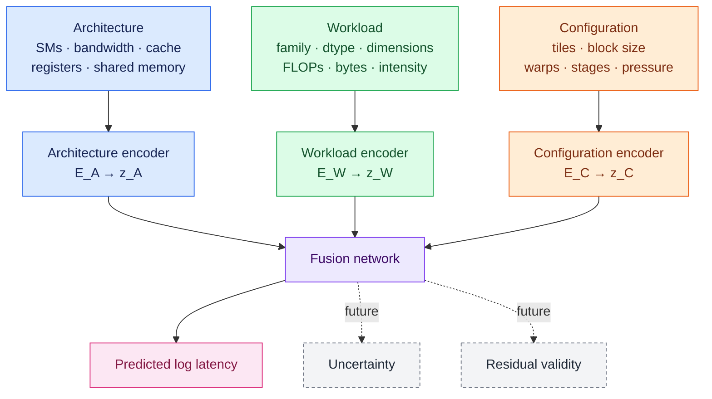

# Architecture-Aware Surrogate Modeling for GPU Autotuning

## Project goal

This project studies whether a surrogate can transfer GPU autotuning knowledge
across architectures. Given a GPU, a workload, and a candidate execution
configuration, the model predicts median kernel latency. The final system will
use latency, uncertainty, and validity estimates to reduce the number of
configurations that must be measured on a new GPU.

The current workload families are GEMM, row softmax, and fused
cross-entropy/reduction.

## Encoder architecture



The three embedding spaces do not need to have the same dimensionality. The
fusion network can concatenate vectors of different sizes:

$$
z_A \in \mathbb{R}^{d_A}, \qquad
z_W \in \mathbb{R}^{d_W}, \qquad
z_C \in \mathbb{R}^{d_C}.
$$

The current baseline uses
$d_A=d_W=d_C=16$ to keep the first experiment controlled. A reasonable next
comparison is $(d_A,d_W,d_C)=(8,16,16)$, since the architecture input has far
fewer distinct examples than the workload and configuration inputs. Embedding
sizes should be selected using validation performance rather than assumed to
be equal. Large architecture embeddings are especially likely to overfit when
only a few GPU models are available.

## Current data

The standard collection grid produces at most 816 unique measurements per GPU:

| Family | Workloads | Configurations per workload | Rows |
| --- | ---: | ---: | ---: |
| GEMM | 12 | 48 | 576 |
| Softmax | 10 | 12 | 120 |
| Cross-entropy | 10 | 12 | 120 |

One row represents one unique
`(architecture, workload, configuration)` measurement. Timing repetitions
improve the reliability of that row but are not additional training samples.

This dataset is sufficient for a pilot latency model on one architecture. It
is not sufficient to establish cross-architecture transfer.

## Data required next

### Architectures

- Collect the same core grid on A100 and H100.
- Obtain a third architecture that is held out completely during training.
- Prefer four or more architectures for leave-one-architecture-out evaluation.

### Workloads

- Increase each family to at least 30 distinct workload IDs per architecture.
- Include small, medium, and large working sets.
- Include square, tall, and wide GEMMs.
- Include power-of-two and irregular reduction widths.
- Include workload sizes below, near, and above cache-capacity boundaries.
- Preserve an overlapping core workload grid across every architecture.

### Configurations and validity

- Target 15--30 or more configurations per workload.
- Cover conservative, high-performing, and legal-but-poor configurations.
- Collect naturally invalid and near-resource-limit configurations.
- Preserve the compiler or runtime failure category rather than creating fake
  invalid labels.
- Keep correctness failures separate from resource and compilation failures.

### Recommended scale

The immediate target is approximately 2,000--3,000 unique rows per
architecture:

```text
3 families
× 30--50 workloads per family
× 15--30 configurations per workload
= 1,350--4,500 possible rows per architecture
```

Coverage and family balance are more important than reaching an exact row
count.

## Experimental plan

1. Train the current three-encoder latency baseline on valid rows.
2. Split by complete workload IDs so configurations from one workload cannot
   leak across training and evaluation.
3. Compare equal and unequal embedding dimensions.
4. Compare against global and family medians, gradient-boosted trees, and an
   architecture-agnostic MLP.
5. Train on source GPUs and hold out an entire architecture.
6. Add deterministic legality checks before any learned validity component.
7. Add uncertainty estimation and residual validity prediction.
8. Evaluate configuration selection under target-GPU measurement budgets.

Use budgets $N \in \{0,5,10,25,50\}$ only when a workload has at least 50
candidate configurations. Otherwise cap the budget by the candidate-space size
and report the fraction $N/|\mathcal{C}_W|$ explored.

Primary metrics are latency MAPE/MAE, Spearman rank correlation, top-k regret,
fraction of oracle performance recovered, and invalid-candidate rate. Report
all metrics per family and per held-out architecture.
